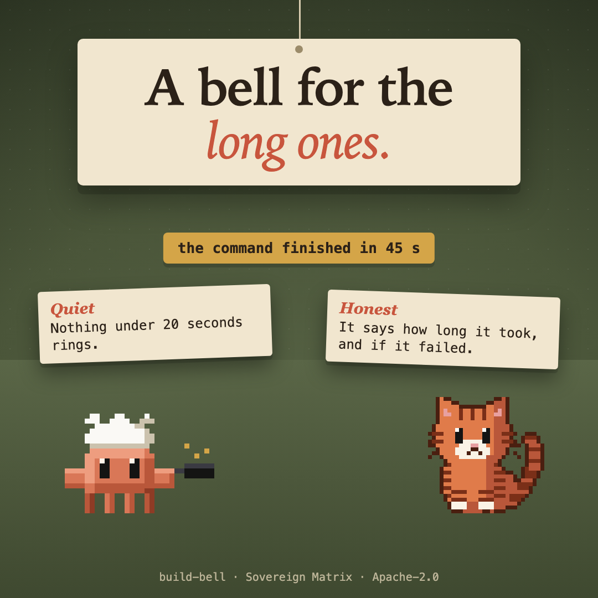

# build-bell



A soft bell and a toast when a long command finishes, so you can look away while a build, an install or a test run goes.

- It rings and shows a toast for a Bash command that ran **20 seconds or more** (set `minSeconds` to change it).
- The toast says how long it took and whether it failed. A command you or a hook refused never rings.
- The bell is a service-desk strike, synthesised for this plugin (`sounds/bell.wav`): a hammer on brass with an inharmonic ring, and a lighter second tap. It plays with `afplay` on macOS and not at all where there is no player. Set `sound` to `false` for the toast alone.
- It reads nothing from the command and sends nothing anywhere.

```
/plugin install build-bell --marketplace christiaan839-beep/sovereign-critters
```

```
claude plugin validate . --strict
claude plugin test .
```

Apache-2.0.
