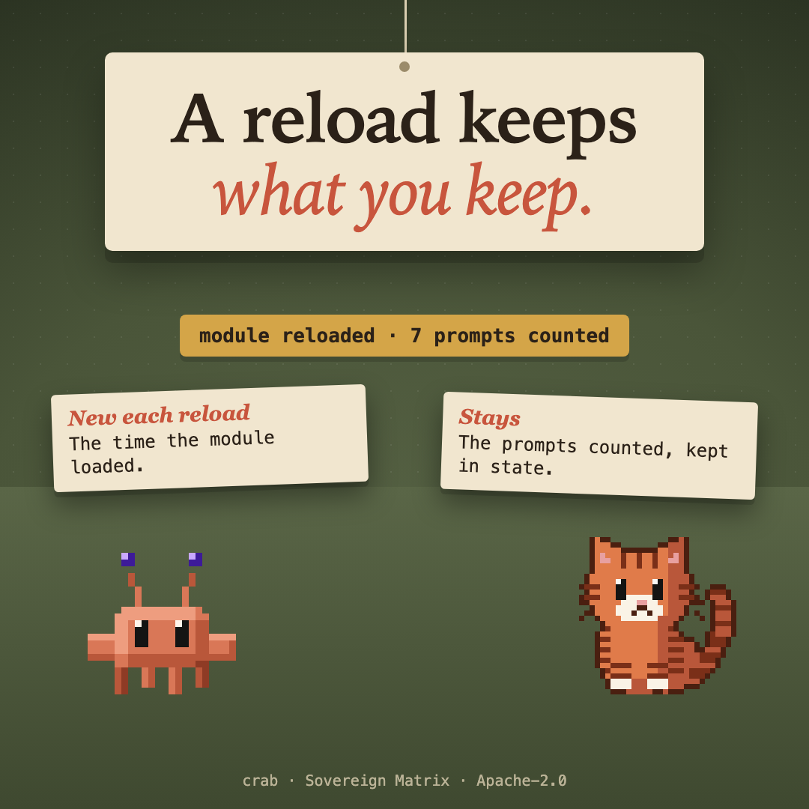

# crab



A band above the prompt, on the terminal and the desktop, that shows what a hot reload keeps. The module's own variable (the time it loaded, in UTC) starts again; the count of prompts, kept in `$.state`, stays.

## What it does

A band above the prompt shows two things side by side: the time the module loaded (a variable in the module itself), and the number of prompts that entered this session (kept in `$.state`).

Run it with `claude --plugin-dir .`, save the module, and watch the band: the load time is new, the count stays. That is the whole lesson of hot reload for a mod.

## Where it draws

The terminal and the desktop app.

## Install

```
/plugin install crab --marketplace christiaan839-beep/sovereign-critters
```

Plugins load in a new session. To try it from this folder instead: `claude --plugin-dir .`

## Check

```
claude plugin validate . --strict
claude plugin test .
```

Apache-2.0. Not affiliated with Anthropic.
