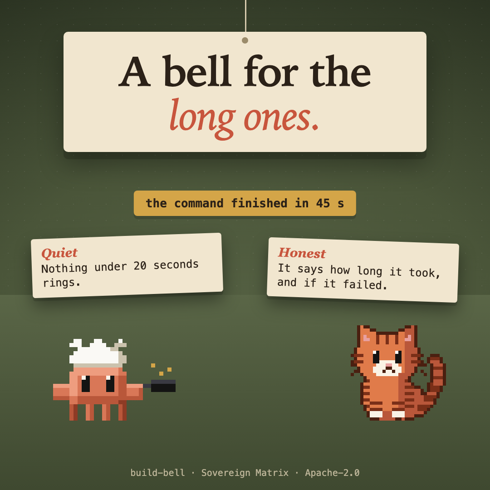

# build-bell



A soft bell and a toast when a long command finishes, so you can look away while a build, an install or a test run goes.

- It rings and shows a toast for a Bash command that ran **20 seconds or more**, and for a **turn** that ran that long: "Claude finished after 1 min 30 s". Change it in the plugin's settings (`minSeconds`).
- A **short turn** (5 seconds to just under the threshold) gets a soft tick, no toast; under 5 seconds, nothing. Set `shortTurns` to `false` to drop the tick.
- A command's toast says how long it took and whether it failed; a turn's toast says how long it took. A command you or a hook refused never rings.
- The bell is a service-desk strike, synthesised for this plugin (`sounds/bell.wav`): a hammer on brass with an inharmonic ring, and a lighter second tap. It plays through the app's own audio, and not at all where there is no player. Set `sound` to `false` for the toast alone.
- It reads nothing from the command and sends nothing anywhere.

## What it never does

- It reads nothing from the command, the file or the prompt: only whether a call ran long and whether it failed.
- It makes no network request and sends no telemetry.
- It keeps no state of its own; its three settings (`minSeconds`, `sound`, `shortTurns`) are yours.

## Install

```
/plugin marketplace add christiaan839-beep/sovereign-critters
/plugin install critter-bell@sovereign-critters
```

## Check

```
claude plugin validate . --strict
claude plugin test .
```

Apache-2.0.
