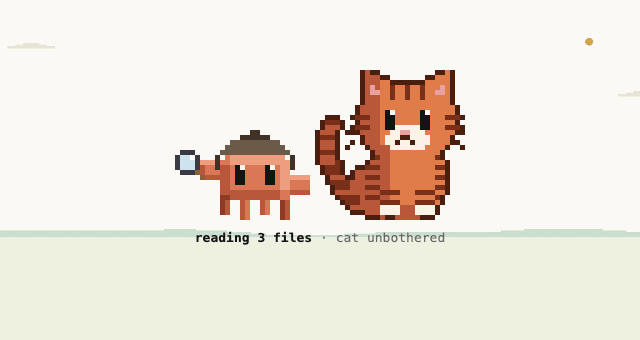

# critter-buddy

The Sovereign Matrix critter, a wizard version of it, and a tabby cat, living in Claude Code's own interface: above the prompt, beside the thinking orb, on every tool row, and behind the conversation on the desktop app.



## What it never does

- It makes no network request and sends no telemetry. State (the scene, the diary, the streak, the habits, your settings) stays in the plugin's own store on this machine.
- It learns your habits as counts and hashes: the hours you work, and a short hash of each folder, never a path or a name. At most 50 hashes are kept.
- **One thing does cost tokens:** after each turn the cat may say a line through one small model call (`/critter talk on`; it is off until you turn it on). The call carries only numbers (the seconds the turn took and the counts of tools, errors and commits), never a command, a path, a file or a prompt. `/critter talk off` stops it and spends nothing.
- Sound is on by default, silent in calm and still and wherever the app has no player; `/critter sound off` turns it off and the choice is kept. Speech is off until you ask (`/critter voice on`).
- `biscuit-looks`, its one agent, can read and search but never edit, and it runs only when you ask it.

## Install

```
/plugin marketplace add christiaan839-beep/sovereign-critters
/plugin install critter-buddy@sovereign-critters
```

Plugins load in a new session.

## What you get

| Where | What it does |
| --- | --- |
| The bar above the prompt (and its buttons: pet, feed, cast, nap, the corner; each label follows what is happening) | The critter changes with the tool Claude uses: laptop for Bash, glasses to read, pencil to edit, wizard hat and staff (built up frame by frame) for a skill or a subagent. The cat sleeps, follows, sits on the laptop, pounces on errors and knocks cups off. |
| Beside the thinking orb | The wizard stands to its left; the orb is the glossy clay Sovereign Matrix orb and breathes while Claude thinks. |
| Every tool row | A small face by what the call did: working, done, failed. |
| End of a turn | A line from the diary and a quip that depends on how long it took and whether anything failed. |
| Footer, hint, greeting | The cat's mood among the modes, a hint that follows what is happening, a greeting that follows the hour in Johannesburg. |
| The sky | Cream by day, dark with a few stars by night (four phases by the hour, Africa/Johannesburg: night 19:00 to 04:59, dawn to 06:59, day to 16:59, dusk to 18:59), with ridges, sun or moon, cloud and rain that follow the weather. Drawn behind the whole chat where the app has a backdrop; where it has none (the desktop app version we tested), it is drawn behind the pair in the band. `/critter doctor` says which. |
| The prompt box | Type `/critter` and the command turns clay, a word it knows turns teal, a stray one is underlined in gold, and a dim line after a finished word says what it does. The typeahead offers the words and the coats. |
| The diary | `/critter diary` and the cat corner show it newest first, the time in teal, the latest line at full strength. |
| The model | A `cat_diary` tool, so Claude can read what the cat wrote. |

The cat keeps its trust in you across sessions in `$.store`; it falls by 8 for each day you are away, never below 40, and a night's sleep forgives a sulk carried over.

## Commands

| Command | Does |
| --- | --- |
| `/critter pet`, `treat`, `nap`, `spell` | The same as the buttons. |
| `/critter stage` | The critter alone on an empty stage, walking and idling. |
| `/critter corner` | The cat corner pane: portrait, moods, diary and a one-key treat game. |
| `/critter diary` | What the cat wrote. |
| (automatic) | The sky: the hour, the season and the session's weather (joy sets it) behind the conversation; the streak and its props (3, 7, 14, 30 days); South African public holidays in the greeting and lights in December; the cat at the window during a call longer than 20 s. Nothing is fetched. |
| `/critter lite`, `full`, `party` | How far it reaches: lite is the bar, the wizard and the orb; full adds the transcript's rows; party adds every message (default). |
| `/critter talk on`, `off` | The cat speaks after each turn through one small model call. Off by default; `on` turns it on, `off` keeps the cat quiet and spends nothing. |
| `/critter cat <coat>` | The cat's coat: `orange` (the default), `ink`, `brown`, `tabby`, `ginger`, `black`, `tuxedo`, `cream`, `grey`, `siamese`, or `pair` (follows day and night). |
| `/critter name cat <name>`, `name pip <name>` | What the cat (Biscuit) and the wizard critter (Pip) are called; every line says it. |
| `/critter wizard auto`, `gold`, `bolt` | The wizard by the hour, the gold star always, or the violet bolt always. |
| `/critter feel calm`, `warm`, `playful`, `still` | How lively they are. Calm: quiet, with no hops, sparks or sound; they still breathe, walk and sleep. Warm: the usual (default). Playful: more hops and sparks. Still: nothing moves at all and there is no sound. |
| `/critter doctor` | What is on and why, in plain words, and the switch that changes each thing, including whether the sky is drawn and how wide the stage and corner will open. |
| `/critter perf` | The clock's own books: beats run, engine calls and milliseconds per beat. |
| `/critter sky auto`, `dawn`, `day`, `dusk`, `night` | The sky follows the hour, or holds one phase. |
| `/critter tint on`, `off` | Each folder leans its own quiet colour in the sky (one of six, from a hash of the folder's path). |
| `/critter sound on`, `off` | A cast chime for a Skill, a purr for a pet, a paw for a treat, a page for the diary and a brass chime for a prop earned. On by default; `off` turns it off and the choice is kept. Silent in calm and still. |
| `/critter voice on`, `off`, `<name>` | The cat says the big moments aloud (a prop earned, the glass nearly full) in the system voice, or in an installed voice you name. Off until you ask; calm stays silent. |
| `/critter hide`, `show` | `hide` always hides and `show` always shows; bare `/critter` toggles. |

It draws above other mods' rows in the same place and registers `/critter` and one agent, `biscuit-looks`: a second look at a change that can read and search but never edit, five lines at most.

## Accessibility

- **Nothing moves** with `/critter feel still`: no walking, hopping, sparks, blinking or breathing, the thinking orb and the wizard hold one frame, and sound and speech are off. `/critter feel warm` brings them back.
- **Colour never carries a meaning alone.** A tool row's face says what the call did in its eyes (`×` failed, `^` done, `-` resting, `▪` working); the band, the doctor and the diary say it in words; a word `/critter` does not know is underlined as well as gold.
- Sound is on by default and silent in calm and still; speech is off until you ask.
- **Pending:** a high-contrast mode for the sky and the characters. Since 0.26.3 every part of the sky has a contrast floor against its paper; a stronger mode is not guessed, it waits for screenshots of the real window.

## Check

```
claude plugin validate . --strict
claude plugin test .
```

## Early access

Mods are on by default from Claude Code 2.1.286. An organization can keep installed mods from running (`allowManagedModsOnly` in managed settings), and `claude --safe-mode` starts a session without them. The mod engine may change between releases without notice: tests pin this mod's behaviour, and when the engine moves, expect a patch release that follows it.


Apache-2.0. See CHANGELOG.md.
