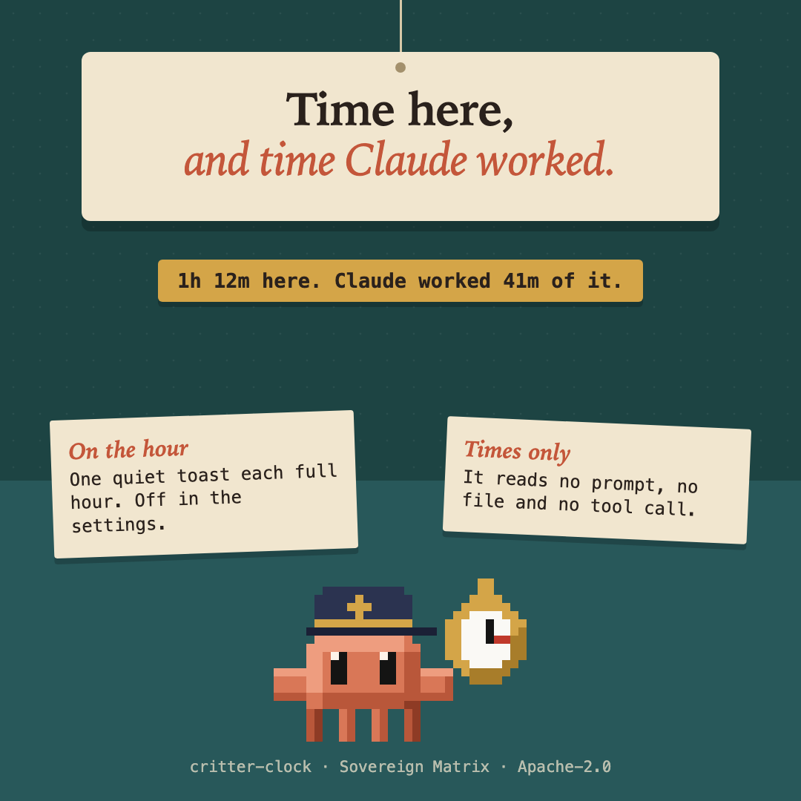

# critter-clock



How long this session has run, and how much of it Claude spent working. Type `/clock`. It also says so once on each full hour, if you leave that on.

```
1h 12m here. Claude worked 41m of it. The longest turn was 6m 40s.
```

## What it does

- `/clock` answers in one line: time since the session began, the total time Claude's turns took, and the longest single turn.
- On each full hour a quiet toast says so ("An hour in. Claude has worked 45m of it."). A session left idle across several hours says the latest hour once, not one toast per hour. Turn this off under **Say so on the hour** in the mod's settings.
- Only the main conversation counts. A subagent's turns run inside the main turn and would count the same minutes twice.

## What it never does

- It keeps times and nothing else: when the session began and how long each turn took. It reads no prompt, no file and no tool call.
- It never blocks anything. Every hook fails open.
- It counts no tokens and no money (that is [critter-ledger](../critter-ledger), and only when you ask).
- It sends nothing anywhere and keeps nothing after the session ends.

## Limits

- The count starts when the mod loads. A session you resume, or a mod you switch on late, starts its count again from then.
- "Worked" is the time of finished turns as the engine reports it. A turn you interrupt is counted as the engine counts it.

## Early access

Mods load only where Claude Code has function hooks enabled, and the mod engine they are written against may change between releases without notice. Tests pin this mod's behaviour; when the engine moves, expect a patch release that follows it.
