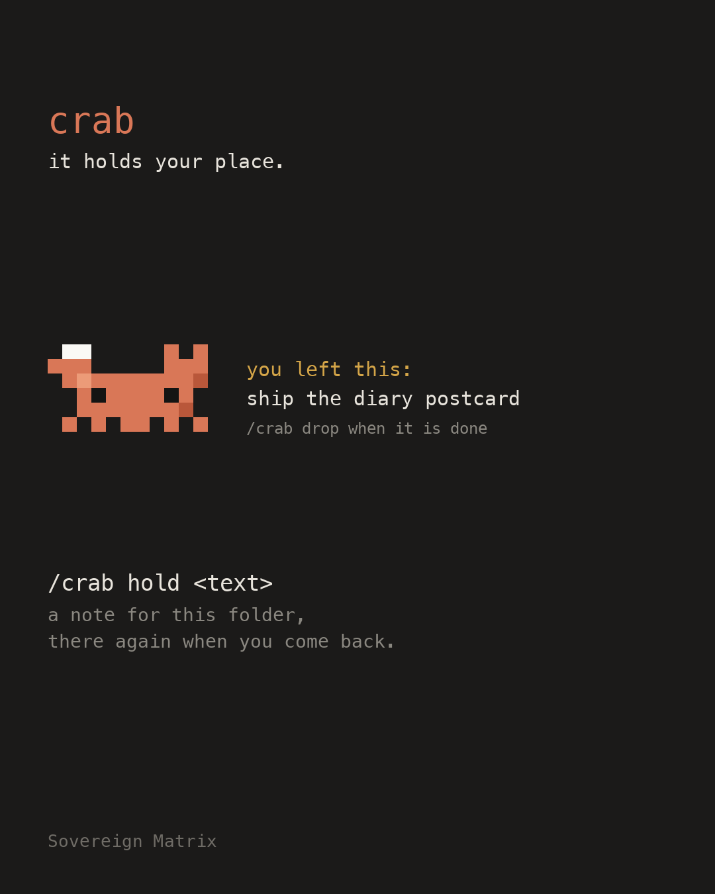

# critter-crab



**Companion** pillar: something alive beside the work. One of thirteen [sovereign-critters](../../README.md#what-is-here) mods.

A small pixel crab that holds a note for you. Tell it where you stopped, and it is there again when you come back to the folder, in a new session, after a restart.

```
/crab hold ask Mira which migration ran before the deploy
```

A band appears above the prompt: the crab, and your note beside it. In the same folder in a later session it says **you left this:** instead of **holding:**, with its age once it is a day old (**you left this 3 days ago:**).

## Commands

| Command | Does |
| --- | --- |
| `/crab hold <text>` | Leaves a note for this folder. One line, 120 characters at most; a longer one is shortened and the crab says so. A second hold replaces the first. |
| `/crab` | Says what the crab is holding for this folder. |
| `/crab drop` | Puts the note down. The band goes. |

## What it looks like

Nothing, until you give it a note: with no note it draws no band at all and costs no space. With one, it is two lines beside the crab, cut with an ellipsis if the window is narrow, never wrapping. The crab is our own drawing, in the same clay as the pair: half blocks in the terminal, a picture on the desktop.

## What it does and sends

- **Keeps one note per folder** in the plugin's own store, under a short hash of the folder's path. The path and the folder's name are never kept. A note is one line of plain text, 120 characters at most (colour codes and control characters are stripped); fifty folders at most, the oldest let go. `/crab drop` removes it.
- **Reads** the note you give it with `/crab hold`, and the hash of the folder the session was opened in. It never reads your prompts, your files or the output of a tool.
- **Draws** a band above the prompt only while a note exists. With no note it draws nothing and costs no space.
- **Sends** nothing: no network request, no telemetry, no sound files, no credentials, no program run. If its store will not read or write, it says so and carries on; it never blocks a tool or a prompt.
- The note is stored on your machine in plain text. Do not put a secret in one.

## Install

```
/plugin marketplace add christiaan839-beep/sovereign-critters
/plugin install critter-crab@sovereign-critters
```

Plugins load in a new session. To try it from this folder instead: `claude --plugin-dir .`

## For mod authors

The first version of this plugin was a band that showed what a hot reload keeps (the module's own variable starts over, `$.state` stays). It is kept as a teaching example in [`examples/hot-reload-demo`](../../examples/hot-reload-demo). This version keeps the same lesson in earnest: the note survives a reload and a restart because it is in `$.store`, not in a variable.

## Check

```
claude plugin validate . --strict
claude plugin test .
```

## Early access

Mods are on by default from Claude Code 2.1.286. An organization can keep installed mods from running (`allowManagedModsOnly` in managed settings), and `claude --safe-mode` starts a session without them. The mod engine may change between releases without notice: tests pin this mod's behaviour, and when the engine moves, expect a patch release that follows it.

Apache-2.0. Not affiliated with Anthropic.
