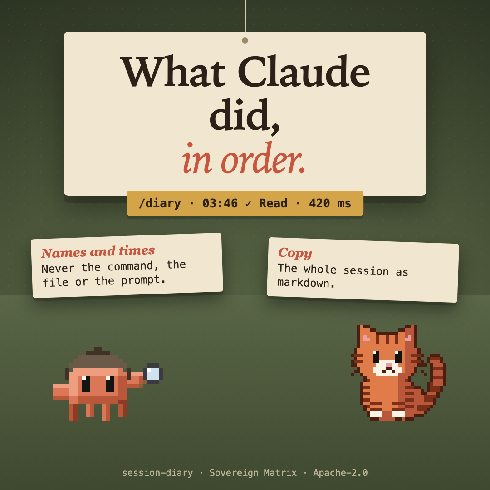

# critter-diary



**Witness** pillar: says what happened, honestly. One of thirteen [sovereign-critters](../../README.md#what-is-here) mods.

`/diary` opens a pane that keeps what Claude did this session.

- **Every tool call**, with the hour (Johannesburg time), whether it succeeded or failed, and how long it took.
- **A line for each turn**: how many tools it used, how many failed, how long it ran.
- **Copy as markdown**: the whole session as a list you can paste into a note or a pull request.

It stores tool names and times only. It never reads the command, the file or the prompt, so there is nothing in it to leak. The session keeps its last 300 lines and is forgotten when the session ends; the week keeps only counts (calls, failures, turns, time, tool names) for 14 days in the plugin's own store, so it survives a restart.

| Command | Does |
| --- | --- |
| `/diary` | Opens the pane. |
| `/diary copy` | Puts the diary on the clipboard as markdown. |
| `/diary clear` | Empties this session's diary and the week. |
| `/diary week` | The last seven days, a bar a day (`/diary week copy` for markdown). |
| `/diary postcard` | This session on one screen: time, turns, calls, busiest hour, tools used most (`/diary postcard copy` for markdown). |

In the pane: `c` copies, `p` copies the postcard, `x` clears, `q` closes.

## What it does and sends

- **Reads:** the name of each tool Claude calls, when it started and how long it took, whether it failed, and when each of your turns ended. It never reads a tool's input or output, your prompts, or your files; the only text it takes from a command is the `/diary` argument you type.
- **Keeps:** the last 300 lines of the session in the session's state, and a per-day count (calls, failures, turns, time, calls per tool name) for fourteen days in the plugin's store, both on this machine. `/diary clear` empties both.
- **Sends:** nothing. It makes no network request, starts no process, calls no model and sends no telemetry. The clipboard is written only when you press copy or run a `copy` command.

## What it never does

- It makes no network request and sends no telemetry. The session diary stays in the plugin's `$.state` and the week in its `$.store`, both on this machine.
- It copies to the clipboard only when you press copy or run a `copy` command.

## Install

```
/plugin marketplace add christiaan839-beep/sovereign-critters
/plugin install critter-diary@sovereign-critters
```

Plugins load in a new session.

## Check

```
claude plugin validate . --strict
claude plugin test .
```

## Early access

Mods are on by default from Claude Code 2.1.286. An organization can keep installed mods from running (`allowManagedModsOnly` in managed settings), and `claude --safe-mode` starts a session without them. The mod engine may change between releases without notice: tests pin this mod's behaviour, and when the engine moves, expect a patch release that follows it.


Apache-2.0. Not affiliated with Anthropic.
