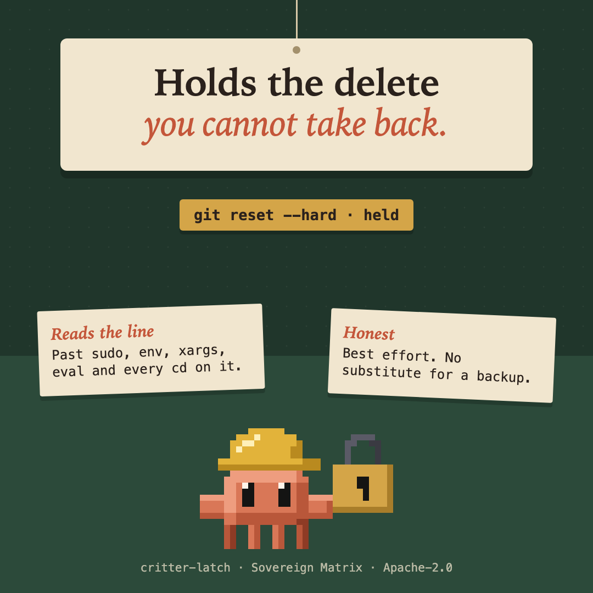

# critter-latch



An opt-in guard against deletes you cannot take back. Install it and it stops these before the Bash tool runs them:

- a recursive `rm` that reaches outside the folder you opened, or would remove that folder or one above it (`rm -rf ..`, `rm -rf ~`, `rm -rf *`);
- `git reset --hard`;
- `git clean -f` (any spelling that forces and is not a dry run);
- `git checkout .`, `git checkout -f`, `git switch -f` (or `--discard-changes`) and `git restore .` over the whole tree; a `--pathspec-from-file` it cannot read waits.

```
latch: rm -r reaches outside the folder you opened (/work/app). Ask the person to run it themselves if they meant it.
```

A recursive delete inside the folder (`rm -rf dist`, `find . -name __pycache__ -exec rm -rf {} +`, `git ls-files | xargs rm -rf`) goes through. So do `git clean -n`, `git reset --soft` and `git checkout main`.

## How it reads

It reads the command line, past `sudo`, `env`, `time`, `nice`, `xargs`, `find -exec`, `bash -c`, `eval`, `echo ... | sh`, `$( )`, backticks, redirects, heredocs, line continuations and shell keywords. It follows `cd`, `pushd` and `popd` on the same line, and when a `cd` might not have happened (after `;`, `||` or in a subshell) it judges a relative target against every folder the command could be in. A target it cannot read (`$VAR`, a brace, a backtick) is held back, not guessed.

## Limits

It is best effort and no substitute for a backup or for version control.

- It reads how a command is spelled, not what a script does. `make clean`, `npm run reset`, `find -delete`, `rsync --delete`, a git alias and a program that deletes on its own are invisible to it.
- It guards `rm` and four git commands. It does not guard `mv`, `dd`, `>` truncation, `git branch -D`, `git stash drop`, `git checkout-index`, `git read-tree --reset` or `git push --force` (that is [critter-ward](../critter-ward)).
- It cannot read options built from a variable (`rm $FLAGS x`), a `case` inside `$( )`, or a `CDPATH` that changes where `cd` goes. A symlink inside the folder that points outside it is not followed.
- `cd sub; make; cd ..; rm -rf build` is held: if the first `cd` had failed, the second would have left the folder. Write it with `&&`. An `eval` of anything but a well-known setup tool's output (`ssh-agent`, `direnv`, `pyenv`, `opam` and the like) is held, and an alias defined elsewhere is invisible.
- It judges the folder the session was opened in (it asks the session for it, so a shell that has since moved is judged against where it began). If it cannot tell which that is, a recursive delete waits.
- It fails closed for a line that names `rm`, `git` or `xargs` and that it cannot read; any other command goes on as if the mod were not there.
- It never reads file contents, keeps nothing and sends nothing.

A command it stopped is refused. A command it could not read (a `$VAR` target, an `eval` of something unknown) is put to you as a question instead, so a false alarm costs one click. To run a refused command anyway, run it yourself in a terminal.
