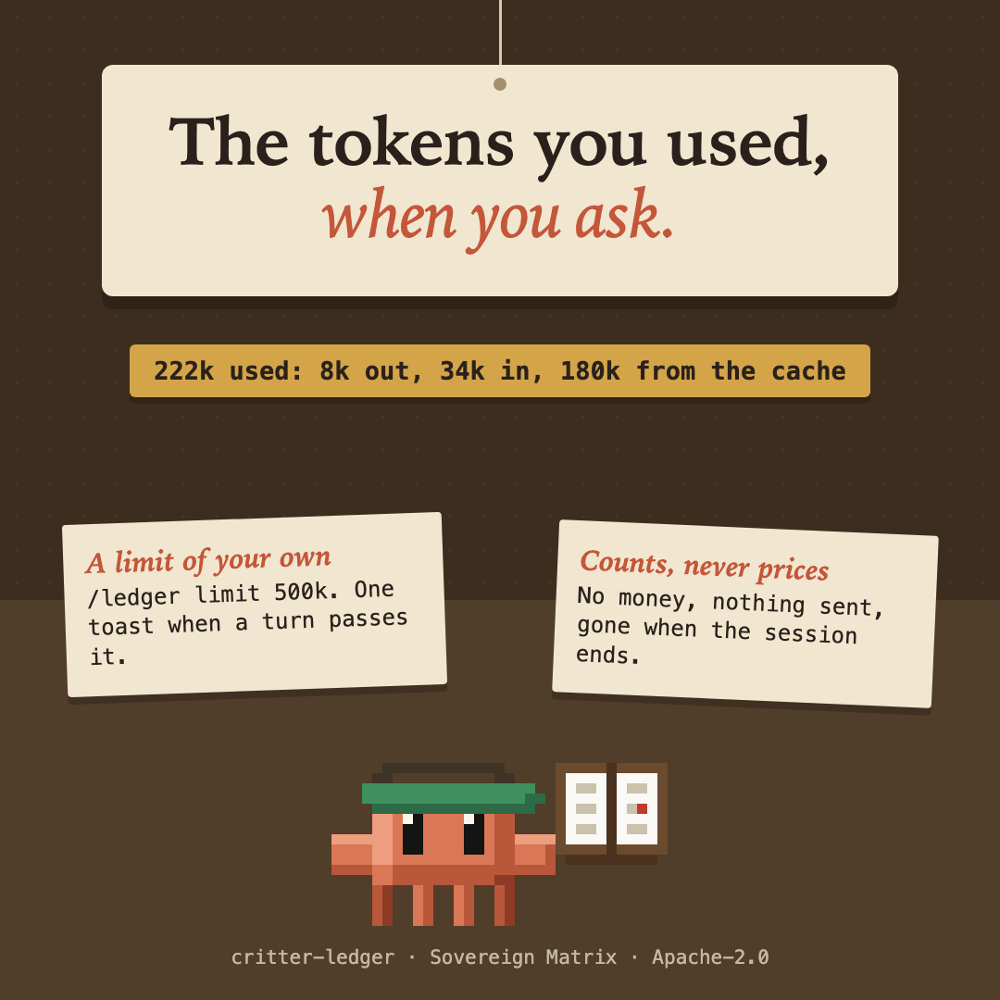

# critter-ledger



The tokens this session has used, when you ask. Type `/ledger`.

```
222k used: 8k out, 34k in, 180k read from the cache. The biggest turn was 222k. You set 500k; you are at 44%.
```

## What it does

- `/ledger` adds up what the API reported for each finished turn: fresh input, input the cache stored, input the cache served, and output. "Used" is all four together; "in" is fresh plus stored; the cache's share is shown on its own because it costs less.
- `/ledger limit 500k` (or `1.5m`, or `250000`) sets a limit of your own. When a turn takes the total past it, a toast says so once. `/ledger limit off` clears it.
- Subagent turns count, because their tokens are really spent.

## What it never does

- It never speaks unasked, except for the one toast when you pass a limit you set yourself.
- It reads no prompt, no file and no tool call, spends no tokens of its own, and sends nothing anywhere. The sums live in the session and go when it ends.
- It never blocks anything.

## Limits

- It counts what the engine reports to a mod on each turn. A model call a plugin makes in the background may not appear.
- The count starts when the mod loads. A session you resume starts its count again from then.
- It is a count, not a bill: it knows nothing about prices or plans.
