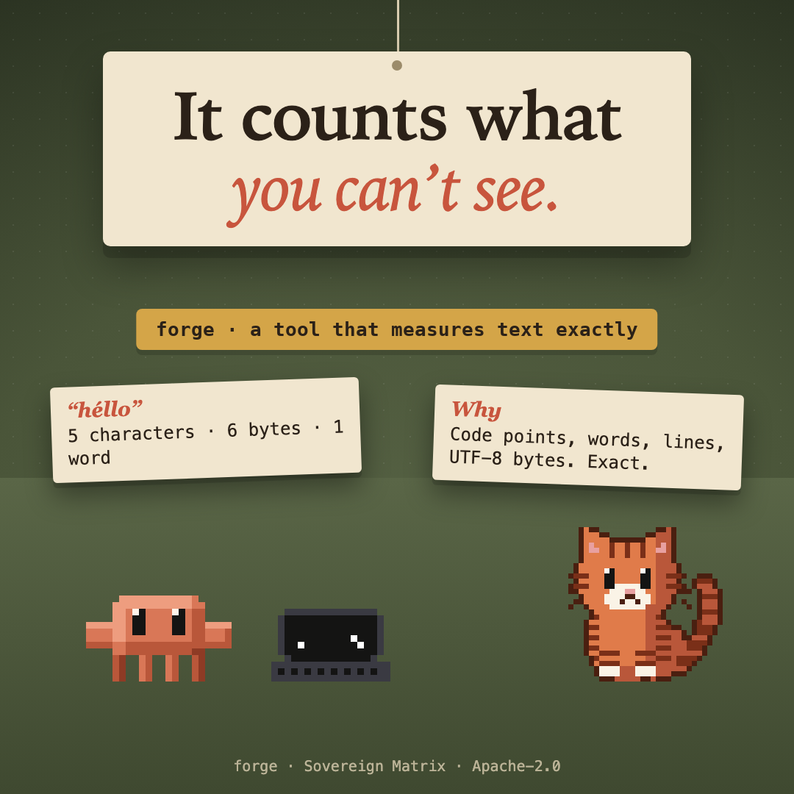

# critter-measure



Gives Claude a tool that counts a text exactly: characters as Unicode code points (so some emoji count as more than one), words, lines and UTF-8 bytes.

## What it does

Registers one tool, `measure`, which the model sees as `mcp__critter-measure__measure`. Give it a text and it answers with:

- **characters**, counted as Unicode code points;
- **words**, **lines**, the **longest line**, and **UTF-8 bytes** (a lone half of an emoji, which is not valid text, counts as the three bytes of the replacement character). It answers a clear message, not a count, if what it is given is not a string.

A model guesses at these. This counts. `héllo` is 5 characters and 6 bytes, because `é` takes two bytes in UTF-8.

## Limits

- It counts the text it is handed. It reads no files and runs nothing.
- Characters are code points, not grapheme clusters: an emoji built from several code points counts as more than one.

## What it never does

- It reads no file, runs no command and makes no network request: it counts the text it is handed.
- It keeps nothing: no state, no log.

## Install

```
/plugin marketplace add christiaan839-beep/sovereign-critters
/plugin install critter-measure@sovereign-critters
```

Plugins load in a new session. To try it from this folder instead: `claude --plugin-dir .`

## Check

```
claude plugin validate . --strict
claude plugin test .
```

## Early access

Mods are on by default from Claude Code 2.1.286. An organization can keep installed mods from running (`allowManagedModsOnly` in managed settings), and `claude --safe-mode` starts a session without them. The mod engine may change between releases without notice: tests pin this mod's behaviour, and when the engine moves, expect a patch release that follows it.


Apache-2.0. Not affiliated with Anthropic.
