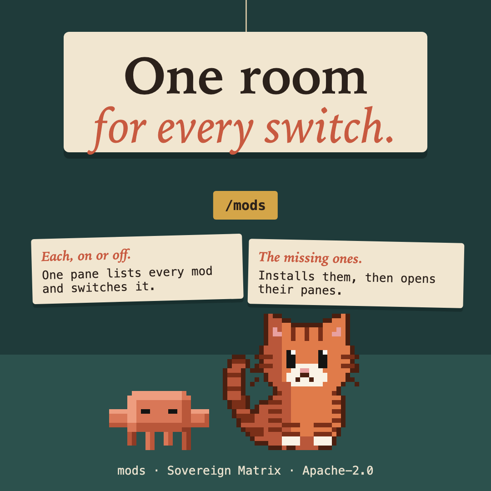

# critter-mods



The control room for the sovereign-critters mods. Type `/mods` and one pane opens, on the right, with every mod in it: whether it is on, a switch for each, and a button for each of its own panes.

```
/mods
```

## What the pane does

Each mod is an index card: its name, its version, a plain line on what it is, how to use it in a few steps, and what is new (the newest entry of the mod's own changelog). On the desktop the card is a picture with a stamp: **ON DUTY**, **AWAKE**, **NAPPING** or **ON LEAVE**, each with its own mark, never colour alone; in a terminal it is a bordered box with the same words. The header has **refresh** and **close**.

- **Lists every mod** with its version and a symbol and word for its state: `●` on, `○` off, `–` not installed. Never colour alone.
- **Stamps each card with its state, in a word and a mark:** ON DUTY (a check), AWAKE (an eye), NAPPING (ZZ), ON LEAVE (dots). critter-buddy leads; the rest follow by state, each alphabetical. Nothing counts your use: the plugin manager gives no such signal, so ON DUTY is critter-buddy when it is on and every other mod that is on is AWAKE.
- **Switches each one on or off.** The switch asks the plugin manager (`claude plugin enable` and `claude plugin disable`), then says plainly that a restart applies it. A mod you switched since this session began is marked "restart to apply" until you do.
- **Installs the missing ones.** A mod that is not installed shows an `install` button; `/mods install all` adds every one and names any that would not install.
- **Opens each mod's own panes**: the cat corner and the stage, the diary, the week, the postcard, the crab's note, the stunt and everywhere panes. It runs that mod's own slash command, so the mod draws its own pane.

## Commands

| Command | Does |
| --- | --- |
| `/mods` | Opens the control room. |
| `/mods list` | The same list as plain lines: works where no pane can open (a headless run, a chat panel). |
| `/mods on <mod>`, `/mods off <mod>` | Switches a mod. `<mod>` is its name (`critter-buddy`) or a short name (`critter`, `diary`, `bell`). |
| `/mods install <mod\|all>` | Installs a missing mod, or all of them. |
| `/mods open <mod> [label]` | Puts the mod's own command in the prompt box (`/critter corner`) for you to send. |

## In the footer

A small chip, `mods 8/8`, shows how many mods are on.

## Look and feel

When critter-buddy is on, the pane also holds its dials: feel (calm, warm, playful, still), reach (lite, full, party), the pair (show, hide) and sound (on, off). Each button runs that mod's own `/critter` command.

## What it never does

- It makes no network request of its own and sends no telemetry. It reads the first 4,000 bytes of each installed mod's own `CHANGELOG.md` for its cards (with `head`, no shell). It starts the `claude plugin` command on your own machine (`list`, `enable`, `disable`, and `install --scope user`, which downloads a mod through that command), and runs other mods' own slash commands for the `open` buttons, and only with a fixed command line built from its list of eight mods: nothing you type is ever passed to a command line, and a name that is not on the list is refused.
- It cannot switch itself off (use `claude plugin disable mods` for that).
- It keeps nothing of its own across sessions: the plugin manager is the truth. Within a session it holds the last list it read and re-reads it when you press refresh, or switch a mod, or open the pane.
- Where there is no plugin manager (a cloud or chat session without the CLI), it says so and draws nothing that could do nothing.

## Install

```
/plugin marketplace add christiaan839-beep/sovereign-critters
/plugin install critter-mods@sovereign-critters
```

Plugins load in a new session. Then `/mods install all` adds the rest.

## Check

```
claude plugin validate . --strict
claude plugin test .
```

Apache-2.0. Not affiliated with Anthropic.
