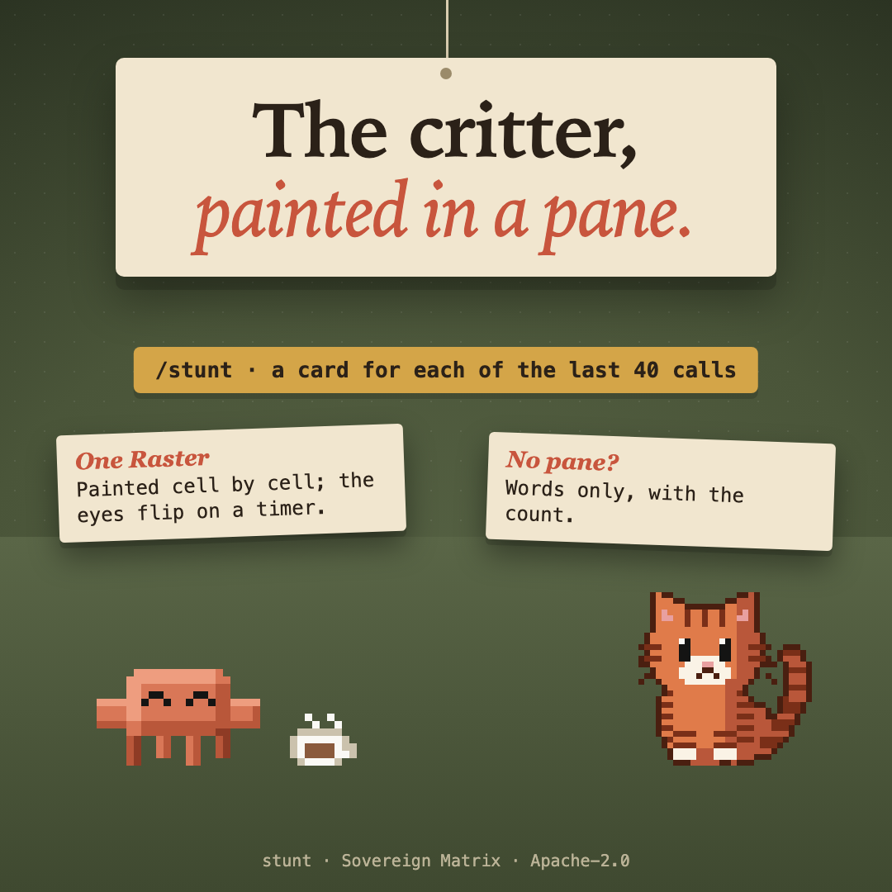

# critter-stunt



**Companion** pillar: something alive beside the work. One of thirteen [sovereign-critters](../../README.md#what-is-here) mods.

A card stunt in the terminal: the critter painted cell by cell in a pane, blinking while it is up, a card for each of the last 40 tool calls beneath it, and the count of every call in words.

## What it does

`/stunt` opens a pane. The critter is painted as one `Raster`; a card stands for each of the last 40 tool calls beneath it. Every four seconds `$.ui.blit` flips its eye cards, with no render pass, for as long as the pane is up in a terminal. Closing the pane stops the timer.

Under it, the words count every call; the total is kept in `$.state`.

## Where it draws

- **Terminal:** the painted critter and the cards.
- **Desktop app:** it has no `Raster`, so it gets the words alone.
- **Nowhere that draws panes:** `/stunt` answers with the count.

## What it does and sends

- **Counts tool calls:** the name of each tool, for the last 40 as cards and a running total, held in the plugin's own session state. Never a command, a path, a prompt or any output.
- **Draws** a pane on `/stunt`: the critter, blinking every four seconds while the pane is up in a terminal, and a card for each recent call. The desktop app has no raster, so it gets the words alone; where no app draws panes, `/stunt` answers with the count.
- **Keeps** the counts for the session only. It uses no on-disk store ($.store) and writes no file of its own.
- **Sends** nothing: no network request, no telemetry, no sound files, no credentials, no program run. Its hook on tool calls counts after the tool has run and never holds one up.

## Install

```
/plugin marketplace add christiaan839-beep/sovereign-critters
/plugin install critter-stunt@sovereign-critters
```

Plugins load in a new session. To try it from this folder instead: `claude --plugin-dir .`

## Check

```
claude plugin validate . --strict
claude plugin test .
```

## Early access

Mods are on by default from Claude Code 2.1.286. An organization can keep installed mods from running (`allowManagedModsOnly` in managed settings), and `claude --safe-mode` starts a session without them. The mod engine may change between releases without notice: tests pin this mod's behaviour, and when the engine moves, expect a patch release that follows it.

Apache-2.0. Not affiliated with Anthropic.
