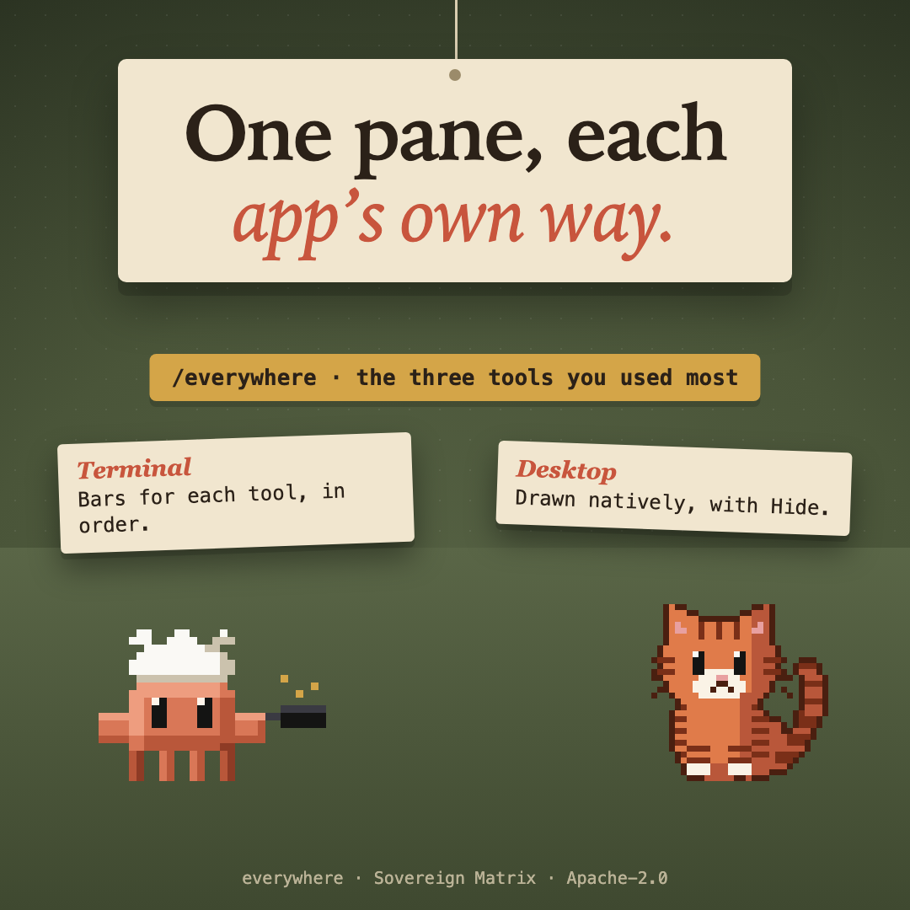

# critter-tally



**Witness** pillar: says what happened, honestly. One of thirteen [sovereign-critters](../../README.md#what-is-here) mods.

/everywhere opens a pane of the three tools the session called most, drawn by each app from its own elements.

## What it does

`/everywhere` opens a pane of the three tools the session called most. Each app draws it from its own elements: a terminal adds a bar for each tool, in order; the desktop app draws it natively. A **Hide** button closes it, and the counts stay in `$.state`.

## Where it draws

Only the terminal and the desktop app draw a mod's panes. The VS Code chat panel and `claude -p` run its hooks and draw nothing, so there `/everywhere` answers with the tally in words.

## What it never does

- It records the name of each tool, never its input or output, and counts them in the plugin's own `$.state`.
- It makes no network request and sends no telemetry.

## Install

```
/plugin marketplace add christiaan839-beep/sovereign-critters
/plugin install critter-tally@sovereign-critters
```

Plugins load in a new session. To try it from this folder instead: `claude --plugin-dir .`

## Check

```
claude plugin validate . --strict
claude plugin test .
```

## Early access

Mods are on by default from Claude Code 2.1.286. An organization can keep installed mods from running (`allowManagedModsOnly` in managed settings), and `claude --safe-mode` starts a session without them. The mod engine may change between releases without notice: tests pin this mod's behaviour, and when the engine moves, expect a patch release that follows it.


Apache-2.0. Not affiliated with Anthropic.
