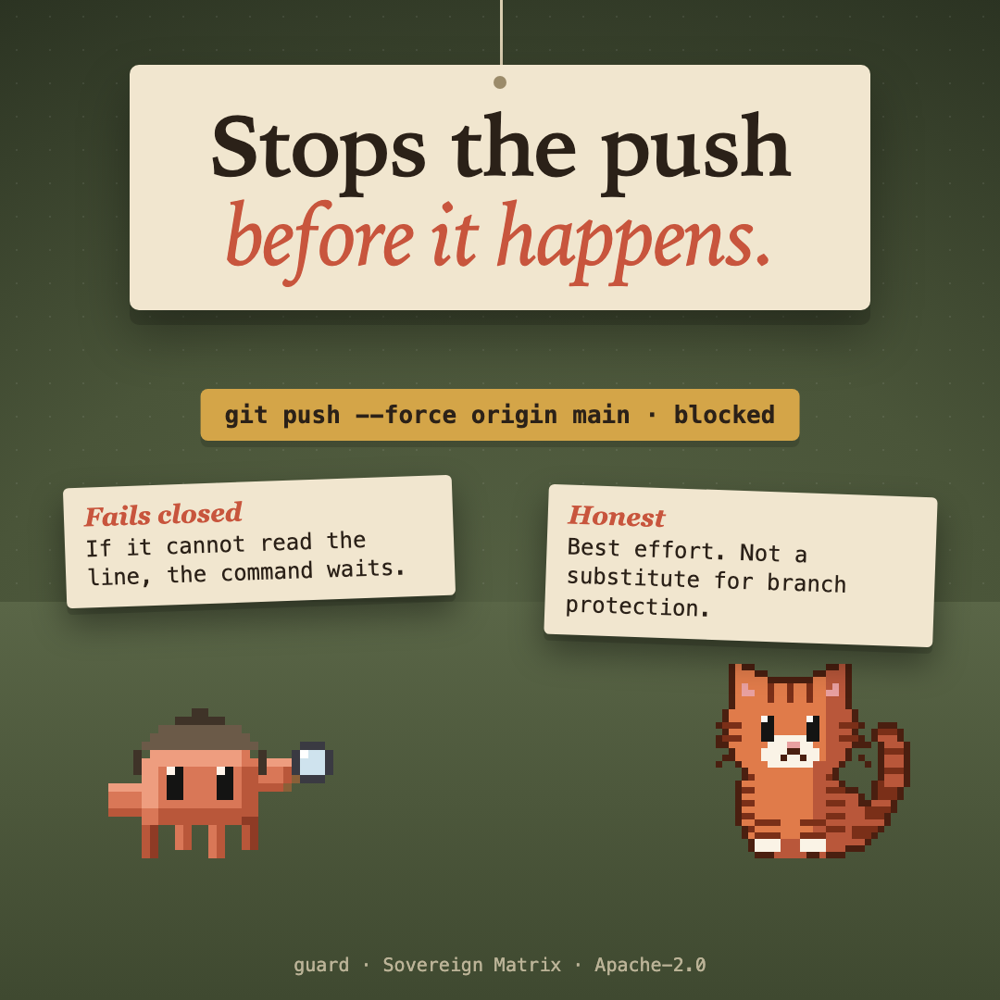

# critter-ward



**Guard** pillar: stops the one thing you cannot take back. One of thirteen [sovereign-critters](../../README.md#what-is-here) mods.

Stops a git push that forces, or that writes main or master, before the Bash tool runs it. It fails closed, and it is best effort: no substitute for branch protection on the server.

## What it does

Before the Bash tool runs a command, `critter-ward` reads it. It stops a `git push` that **forces**, or that **writes `main` or `master`**: by name, as `HEAD`, with `--all`, `--mirror` or `:`, as a delete, or where git's own settings send a branch named on the line.

It reads the common spellings of a command line (quotes, `cd` and zsh's `chdir`, `VAR=` words, wrappers such as `env`, `timeout` and `sudo`, `bash -c`, heredocs), and it asks git where each push really goes.

## It fails closed

If the check cannot finish (git fails or times out, or the line cannot be read), the command waits and the refusal tells the model to ask the person. It also refuses what it cannot read ahead: an expansion, a glob, a `cd` it cannot be sure of, a push run with `PATH`, `GIT_EXEC_PATH` or an `LD_` or `DYLD_` variable set.

## What it does not do

**It stops an accidental push to main or master. It is not a security boundary against a script that is written to get past it.** A shell line can be spelled more ways than any reader can follow, and independent reviews keep finding new spellings; each one found is fixed and kept as a test, but the next one is not found yet. For a rule that must hold, use **branch protection on the server**.

It is **best effort**. A push made by a script or another program (`make`, an npm script, `gh`, an MCP tool, a python or node one-liner, a script file written on the line), and a command built while the line runs, are outside it. A git alias in a config file is read: `git pf` is judged as the `push --force` it stands for. So is a line that changes what a bare `git push` would do through something other than git before it: a `git checkout main --`, `git rebase --root main`, `git bisect reset main`, `git update-ref --stdin`, or a write into `.git/HEAD`, `.git/config`, a gitconfig or a settings file the line then points git at. A git hook written on the line is refused, since a hook can run `git push` at the next commit. The programs a git command starts (`git rebase -x`, `filter-branch --msg-filter`, `fetch --upload-pack`, `-c core.sshCommand=`) are read as scripts. An alias the line itself makes (`git config alias.p "push -f"; git p`) is read and judged.

A script or a command name that is an expansion nobody can read ahead (`eval "$(…)"`, `sh -c "$(…)"`, `… | base64 -d | sh`, `C=$(…); eval "$C"`) is marked for the person to be asked, never refused, since `eval "$(direnv hook zsh)"` is common. The permission check puts such a line to you with the reason, and you decide; a push the guard can read on the same line is still refused. In a permission mode that answers questions for you (auto mode), the question may be answered without reaching you; that was seen with critter-latch on 2026-11-11. It stays a question on purpose: refusing would stop `eval "$(direnv hook zsh)"` and every shell setup line like it.

## What it never does

- It makes no network request and sends no telemetry. It runs `git` locally to ask where a push would go, and nothing else.
- It keeps no state.

## Install

```
/plugin marketplace add christiaan839-beep/sovereign-critters
/plugin install critter-ward@sovereign-critters
```

Plugins load in a new session. To try it from this folder instead: `claude --plugin-dir .`

## Check

```
claude plugin validate . --strict
claude plugin test .
```

## Threat model

| | |
| --- | --- |
| **Protects against** | Claude, or you through Claude, pushing to `main` or `master`, or force-pushing, by accident: a wrong branch, a habit, a line written too fast. |
| **Not against** | Someone who means to get past it: a script, a program that pushes on its own, a spelling no reader has seen yet. A prompt injection that writes such a script is outside it too. |
| **Where it looks** | The command line of Claude's Bash tool, before it runs (`tool.call`). Not your own terminal, not another mod's `$.process` calls, not what a program does once started. |
| **How it fails** | Closed, for its one promise: a push it cannot place (git fails or times out, the line cannot be read) waits, and the refusal says to ask the person. A line that runs an expansion it cannot read is put to you as a question, not refused. |
| **Where it does not run** | Where it does not run at all: on a machine whose organization sets `allowManagedModsOnly` (no mod a person installs runs its hooks), in a `claude --safe-mode` session, under `disableAllHooks`, and in a folder before you answer its trust prompt. Check `/plugin` before counting on it on a managed machine. In auto mode a question may be answered without reaching you. |
| **Review record** | Three independent red-team rounds (2026-11-11 and 2026-11-12), a documentation audit, and the alias gap closed. The third, on 0.3.6, ran about 650 spellings through its reader and judge against real git and found 1 high (zsh's `chdir`) and 3 medium (`tcsh -c` and other shells, zsh's `=git`, `MAIN` on a case-insensitive remote), all fixed in 0.3.7 with a test that failed first. Seen in the desktop app refusing `git push --force origin main`. Open high findings: none. Known gaps: a program that moves `main` earlier on the line is not tracked; the question for an unreadable expansion has not been seen in the real app. `QUALITY.md` has the full record. |
| **The real control** | Branch protection on the server. |
| **Found a way past it?** | That counts as a vulnerability: report it privately, as [`SECURITY.md`](../../SECURITY.md) says. |

## Early access

Mods are on by default from Claude Code 2.1.286. An organization can keep installed mods from running (`allowManagedModsOnly` in managed settings), and `claude --safe-mode` starts a session without them. The mod engine may change between releases without notice: tests pin this mod's behaviour, and when the engine moves, expect a patch release that follows it.


Apache-2.0. Not affiliated with Anthropic.
