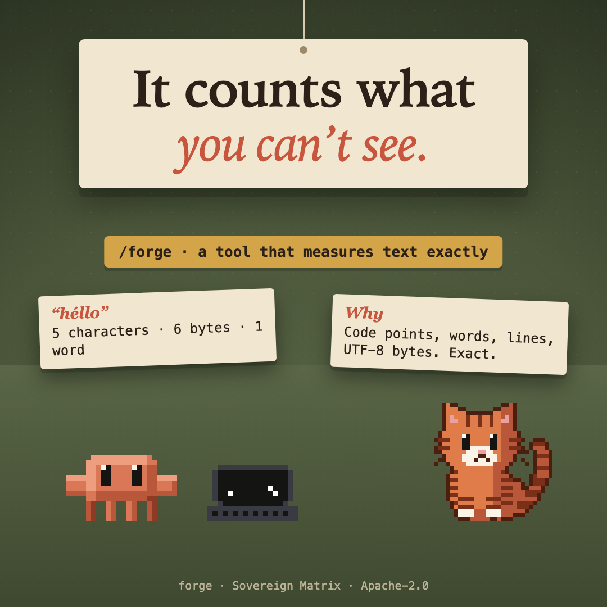

# forge



Gives Claude a tool that counts a text exactly: characters as Unicode code points (so some emoji count as more than one), words, lines and UTF-8 bytes.

## What it does

Registers one tool, `measure`, which the model sees as `mcp__forge__measure`. Give it a text and it answers with:

- **characters**, counted as Unicode code points;
- **words**, **lines**, and **UTF-8 bytes**.

A model guesses at these. This counts. `héllo` is 5 characters and 6 bytes, because `é` takes two bytes in UTF-8.

## Limits

- It counts the text it is handed. It reads no files and runs nothing.
- Characters are code points, not grapheme clusters: an emoji built from several code points counts as more than one.

## Install

```
/plugin install forge --marketplace christiaan839-beep/sovereign-critters
```

Plugins load in a new session. To try it from this folder instead: `claude --plugin-dir .`

## Check

```
claude plugin validate . --strict
claude plugin test .
```

Apache-2.0. Not affiliated with Anthropic.
