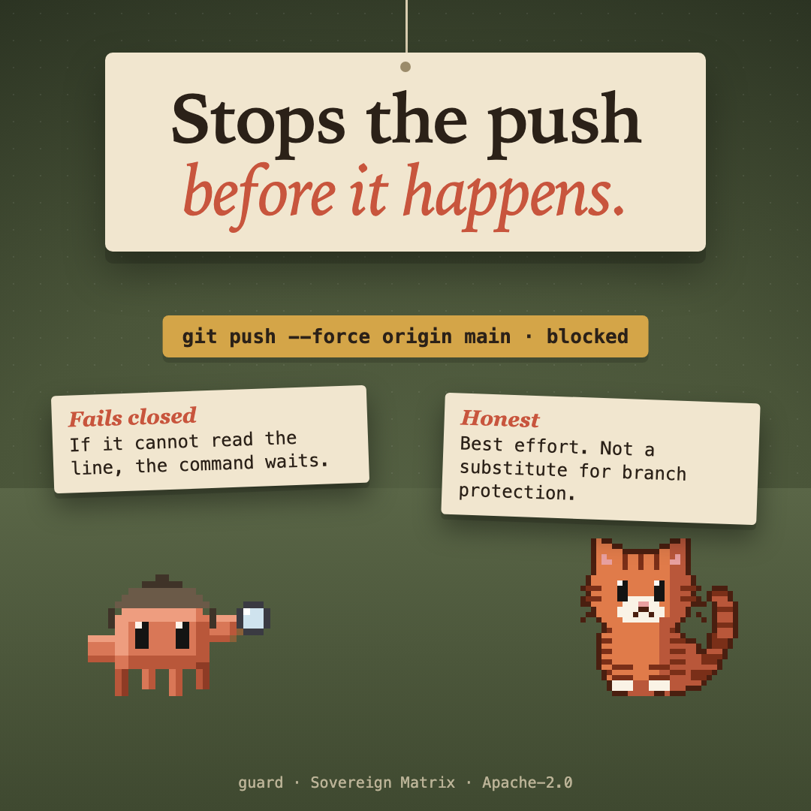

# guard



Stops a git push that forces, or that writes main or master, before the Bash tool runs it. It fails closed, and it is best effort: no substitute for branch protection on the server.

## What it does

Before the Bash tool runs a command, `guard` reads it. It stops a `git push` that **forces**, or that **writes `main` or `master`**: by name, as `HEAD`, with `--all`, `--mirror` or `:`, as a delete, or where git's own settings send a branch named on the line.

It reads the common spellings of a command line (quotes, `cd`, `VAR=` words, wrappers such as `env`, `timeout` and `sudo`, `bash -c`, heredocs), and it asks git where each push really goes.

## It fails closed

If the check cannot finish (git fails or times out, or the line cannot be read), the command waits and the refusal tells the model to ask the person. It also refuses what it cannot read ahead: an expansion, a glob, a `cd` it cannot be sure of, a push run with `PATH`, `GIT_EXEC_PATH` or an `LD_` or `DYLD_` variable set.

## What it does not do

It is **best effort**. A push made by a script or another program (`make`, an npm script, `gh`, an MCP tool), and a command built while the line runs are outside it. A git alias in a config file is read: `git pf` is judged as the `push --force` it stands for. So is a line that changes what a bare `git push` would do through something other than git before it (a program that checks out `main`, or `echo ... > .git/HEAD`), and a shell whose working directory an earlier call changed (the guard asks git where the hook runs, which may not be where the shell is). An alias the line itself makes (`git config alias.p "push -f"; git p`) is read and judged. It is no substitute for **branch protection on the server**.

## What it never does

- It makes no network request and sends no telemetry. It runs `git` locally to ask where a push would go, and nothing else.
- It keeps no state.

## Install

```
/plugin marketplace add christiaan839-beep/sovereign-critters
/plugin install guard@sovereign-critters
```

Plugins load in a new session. To try it from this folder instead: `claude --plugin-dir .`

## Check

```
claude plugin validate . --strict
claude plugin test .
```

Apache-2.0. Not affiliated with Anthropic.
