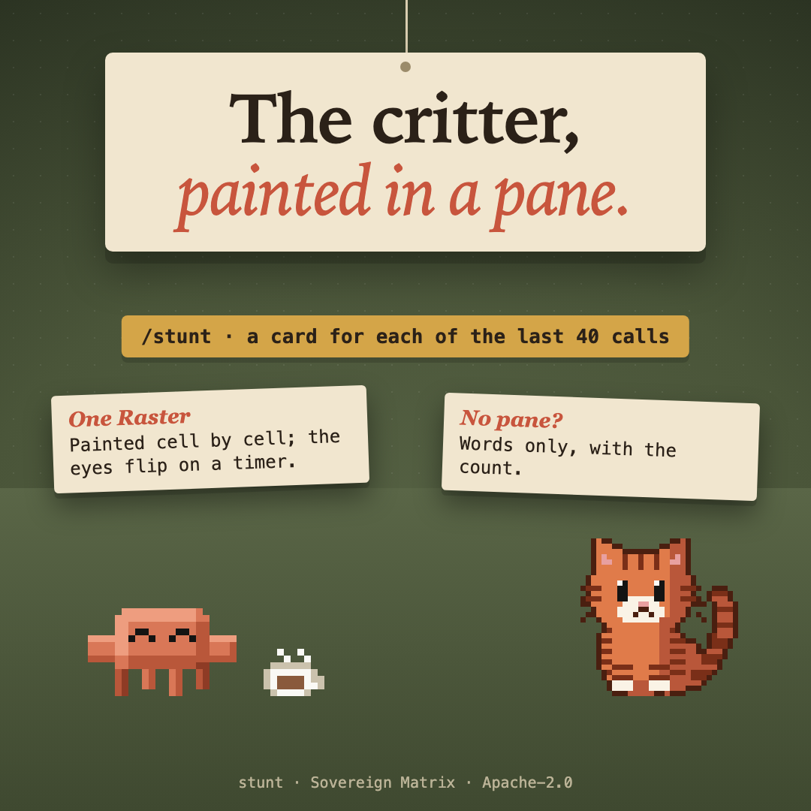

# stunt



A card stunt in the terminal: the critter painted cell by cell in a pane, blinking while it is up, a card for each of the last 40 tool calls beneath it, and the count of every call in words.

## What it does

`/stunt` opens a pane. The critter is painted as one `Raster`; a card stands for each of the last 40 tool calls beneath it. Every four seconds `$.ui.blit` flips its eye cards, with no render pass, for as long as the pane is up in a terminal. Closing the pane stops the timer.

Under it, the words count every call; the total is kept in `$.state`.

## Where it draws

- **Terminal:** the painted critter and the cards.
- **Desktop app:** it has no `Raster`, so it gets the words alone.
- **Nowhere that draws panes:** `/stunt` answers with the count.

## Install

```
/plugin install stunt --marketplace christiaan839-beep/sovereign-critters
```

Plugins load in a new session. To try it from this folder instead: `claude --plugin-dir .`

## Check

```
claude plugin validate . --strict
claude plugin test .
```

Apache-2.0. Not affiliated with Anthropic.
